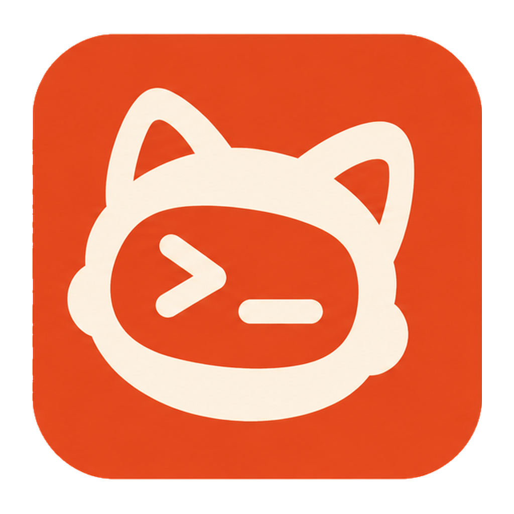

<p align="center">
  
</p>

<h1 align="center">PeachyPet</h1>

<p align="center">
  A living mascot that floats above your windows, reacts to Claude Code and Codex, and lets you handle everything without leaving your flow.
</p>

<p align="center">
  <a href="https://github.com/Sebastian-Su/peachy-code/releases/latest"></a>
  
  
  
</p>

<p align="center">
  <a href="https://github.com/Sebastian-Su/peachy-code/releases/latest"><strong>Download</strong></a> · <a href="https://github.com/Sebastian-Su/peachy-code"><strong>Source</strong></a>
</p>

---

<!-- Add a screenshot or GIF here:  -->

## Features

| | Feature | Description |
|---|---|---|
| 🎭 | **Animated overlay** | A mascot that floats above all windows and reacts to Claude Code, Codex, and Copilot CLI state — click or hover to interact |
| 🔐 | **Permission handling** | Approve, deny, or defer tool use requests from a speech bubble — select with `⌘1-9`, permissions stack in a queue |
| 💬 | **Question answering** | Answer Claude's questions directly from the overlay |
| 📋 | **Plan review** | Review and approve plans without opening your terminal |
| ⏳ | **Waiting-for-input cards** | When a session has been idle waiting for your reply, the overlay shows a timed card until you respond |
| 📥 | **Inbox** | Pending requests on top, one timeline of notifications, approvals, and activity below — filter by project or agent |
| 📊 | **Sessions** | Active and recent sessions with titles, subagents, and a route from engine to host app (terminal, Codex Desktop, Paseo) |
| 🤖 | **Agents** | Hook install status, session counts, and host distribution for Claude Code, Codex, and Copilot CLI, plus a connection doctor |
| 🛠️ | **Services console** | Start, stop, and restart local services and one-off scripts, read their logs, and manage brew services and your LaunchAgents ([details](#services)) |
| 🐾 | **Pet gallery** | Switch pets, download more from the online catalog, or create your own in the creation center |
| 🎨 | **Skins** | Cream, Peach, Sunset, Night, or a custom accent color with automatic text contrast |
| 🌐 | **English & Chinese** | Switch the interface language in Settings |
| 🖥️ | **Find the right terminal** | Jump to the correct terminal tab — iTerm2, Terminal.app, Ghostty, VS Code, Cursor, JetBrains IDEs, and more |
| 🔀 | **Session switcher** | Double-tap `⌘` to switch between assistant sessions |
| 😴 | **Snooze** | Right-click to hide the mascot for 15 min, 1 hour, or indefinitely |
| ↔️ | **Resizable** | Drag to resize or pick a preset (S / M / L / XL) from the context menu |
| 🚀 | **Launch at login** | Optional, from Settings → General |
| 🔄 | **Auto-updates** | Built-in Sparkle updates — always on the latest version |

## How It Works

```
┌─────────────┐     hook events     ┌─────────────┐
│ Claude/Codex │ ──────────────────▶ │ PeachyPet   │
│  (terminal)  │                     │  (menu bar)  │
└─────────────┘                     └─────────────┘
        │                                   │
        │  streams events from hooks/logs,  │  updates mascot animation,
        │  sessions, notifications          │  shows permission prompts,
        │                                   │  tracks sessions
        ▼                                   ▼
   ~/.claude/settings.json          local HTTP :45832
```

1. **Download the app** — Install the DMG. Lives in your menu bar, no dock clutter.
2. **Grant accessibility** — Needed for global shortcuts. First launch installs Claude Code hooks into `~/.claude/settings.json` and Codex hooks into `~/.codex/hooks.json`.
3. **Pick a mascot** — New installs start with PeachMilky, downloaded on first launch. Pick another from the Pets page any time.
4. **Start coding** — Open Claude Code, Codex (CLI or Desktop), or Copilot CLI. Your mascot springs to life.

Each integration can be turned off in Settings → General → Tools; a disabled integration stays off after restart. Codex sessions are also picked up by polling `~/.codex/sessions/`, so sessions show up even before the first hook arrives.

## Main Window

Open it from the menu bar or with `⌘M`. Six sections:

| Section | What's there |
|---|---|
| **Inbox** | Pending permission requests, questions, and waiting-for-input sessions you can answer in place; history below. `↑ / ↓` to move, `U` to mark read |
| **Sessions** | Active sessions first, then recently ended ones. Details show which engine the session runs on and which app the jump button opens |
| **Agents** | Whether each agent's hooks are actually installed, how many sessions it has, and where they run |
| **Services** | Local services, scripts, brew services, and LaunchAgents — see below |
| **Pets** | Installed pets, the online catalog, and the creation center |
| **Settings** | General, Shortcuts, Notifications, Appearance |

## Services

The Services page puts the things you usually start from a terminal in one place: ComfyUI, Ollama, an `npm run dev` server, a `git-pull-all` script.

**Register** — Each entry is one JSON file in `~/.peachypet/services/<id>.json`. The page picks up new, changed, and removed files within a second; a broken file is flagged on its own without hiding the others.

```json
{"schema":1,"name":"Ollama","kind":"service","command":"ollama serve","url":"http://127.0.0.1:11434","port":11434}
```

`kind` is `service` (long-running: start / stop / restart) or `task` (runs once: shows exit code, duration, and the last lines of output). Optional fields: `cwd`, `url`, `port`, `env`, `note`. The format is defined in [docs/service-registry.md](docs/service-registry.md) and [docs/service-registry.schema.json](docs/service-registry.schema.json), so you can ask an AI agent to "register X with PeachyPet" and have it write the file. Registering never starts anything.

**Run** —
- Commands run through your login shell (`zsh -lc`), so conda, fnm, and Homebrew paths work as they do in your terminal.
- Services are handed to launchd for the current login only (`com.peachypet.service.<id>`). They keep running if PeachyPet quits or updates, and they never start at login. Stopping removes the launchd job.
- Before a command runs for the first time, PeachyPet shows the full command, working directory, and environment and asks you to confirm. If any of the three changes later, you're asked again; renaming or editing the URL or note doesn't trigger a new prompt.
- Logs live in `~/Library/Logs/PeachyPet/services/<id>.log`, capped at 5 MB, with credentials redacted. View them from the page or open the service's URL in your browser.

**Status** —
- With a `port`, a service that's listening shows as running even if you started it in a terminal ("started outside PeachyPet"). You can stop it after confirming the PID and command line, or restart it so PeachyPet takes over.
- If the port is held by an unrelated process, the entry says so and offers no stop button.
- Entries whose working directory or executable is missing are marked invalid. Deleting an entry moves its file to the Trash.
- Status only refreshes while the page is open.

**System services** —
- brew services and your own LaunchAgents can be started, stopped, and restarted. This affects the current login only: PeachyPet uses `launchctl`, never `brew services stop`.
- Start at login is a separate switch that asks before turning off.
- LaunchAgents that ship with other apps are collapsed and read-only.
- System daemons are shown only when their program lives under `/usr/local`. They are read-only; PeachyPet gives you a `sudo` command to copy and never runs `sudo` itself.

## Pets

- **Catalog** — "Browse more" on the Pets page lists pets from [Sebastian-Su/peachy-mascots](https://github.com/Sebastian-Su/peachy-mascots). Downloads are checked against their SHA-256 before install.
- **Creation center** — Pets → Create builds a pet from a character image: Idle, Working, Needs Attention, and Thinking loops plus the transitions between Idle and each state, encoded as HEVC with alpha. Generation runs through a built-in mock provider or a custom HTTP provider; API keys stay in the macOS Keychain. Projects can be exported as `.masko` packages. See [docs/masko-creation-center-spec.md](docs/masko-creation-center-spec.md).
- **Import JSON** — Paste a compatible animation JSON from the dashboard.

## Keyboard Shortcuts

All shortcuts work globally — no need to focus the app.

| Shortcut | Action |
|---|---|
| `⌘M` | Toggle main window (customizable in Settings) |
| `⌘1-9` | Select Nth pending permission |
| `⌘Enter` | Approve selected permission |
| `⌘Esc` | Deny / dismiss permission |
| `⌘L` | Collapse / defer topmost permission |
| `Double-tap ⌘` | Open session switcher (2+ sessions) |
| `↑ / ↓` | Navigate session switcher |
| `Tab / Shift+Tab` | Cycle sessions |
| `Enter` | Confirm session selection |
| `Esc` | Close session switcher |

The focus toggle shortcut can be rebound to any key combination in Settings → Shortcuts, and global shortcuts can be turned off there.

Right-click the mascot to open the **context menu** — snooze, resize, or close the overlay.

## Supported Terminals & IDEs

PeachyPet works with terminals that run Claude Code, Codex, or Copilot CLI. How precisely it can jump back varies by app:

| Level | App | How |
|---|---|---|
| **Exact tab** | VS Code, VS Code Insiders, Cursor, Windsurf, Antigravity | IDE extension (auto-installed) |
| **Exact tab** | iTerm2, Terminal.app | AppleScript TTY matching |
| **Exact tab** | PyCharm, IntelliJ IDEA, WebStorm, GoLand, CLion, PhpStorm, RubyMine, Rider | JetBrains plugin (`extensions/jetbrains`) |
| **App** | Codex Desktop, Paseo | Opens the app (Paseo jumps to the agent) |
| **App focus** | Ghostty, Kitty, WezTerm, Alacritty, Warp, Zed | Process activation |

Click a session in the dashboard or click the mascot overlay to jump to the right terminal.

## Requirements

- macOS 14.0+ (Sonoma)
- Apple Silicon or Intel Mac
- At least one of [Claude Code](https://docs.anthropic.com/en/docs/claude-code), [Codex](https://github.com/openai/codex) (CLI or Desktop), or GitHub Copilot CLI

## Install

Download the latest `.dmg` from [**Releases**](https://github.com/Sebastian-Su/peachy-code/releases/latest).

## Build from Source

```bash
git clone https://github.com/Sebastian-Su/peachy-code.git
cd peachy-code
swift build
swift run
```

To install a build into `/Applications`, use the packaging script — it signs the app properly so macOS keeps your accessibility and notification permissions across rebuilds:

```bash
bash scripts/build-app.sh dist
```

`scripts/create-dmg.sh` builds the DMG, and `scripts/publish-pet.sh` packages and uploads a pet to the catalog.

## Troubleshooting

- **Settings → General → Run Connection Doctor** (also linked from the Agents page) checks and repairs the link between PeachyPet and your agents.
- Logs: `log stream --predicate 'subsystem == "com.peachy.pet"' --level debug`
- Data: `~/Library/Application Support/PeachyPet/` (sessions, events, notifications, mascots, pets)

## Local Codex Smoke Test

Boot PeachyPet from source in one terminal:

```bash
swift run PeachyPet
```

Run a live Codex mascot flow in another terminal:

```bash
scripts/codex-mascot-smoke.sh --manual
```

Run the automated 3-step integration check instead:

```bash
scripts/codex-mascot-smoke.sh --auto
```

The automated mode verifies that PeachyPet ingests:
- non-blocking Codex `PreToolUse` and `PostToolUse` lifecycle events
- the final completion marker without blank notifications

The automated mode drives Codex through its own PTY and verifies PeachyPet ingestion. Codex approval requests remain under Codex's configured reviewer, including automatic review. Use `--manual` if you want to inspect the overlay while the lifecycle events are live.

## Project Structure

```
Sources/
├── Adapters/        # Claude Code, Codex, and Copilot event adapters
├── App/             # App entry point & lifecycle
├── Models/          # Data models (sessions, events, skins, service registry)
├── Services/        # HTTP server, hook installers, Codex monitor, service launcher, pet installer
├── Stores/          # Observable state (sessions, inbox, mascots, services, skins)
├── Views/           # SwiftUI views (overlay, inbox, sessions, agents, services, pets, settings)
├── Utilities/       # Helpers (storage, logging, localization, terminal focus)
└── Resources/       # Assets, fonts, default pets, en/zh strings
docs/                # Specs and the service registry format
scripts/             # Build, DMG, smoke test, and pet publishing scripts
extensions/
├── vscode/          # VS Code/Cursor click-to-focus extension
└── jetbrains/       # JetBrains (PyCharm, IntelliJ, etc.) terminal focus plugin
```

## Contributing

See [CONTRIBUTING.md](CONTRIBUTING.md) for how to get involved.

## License

[MIT License](LICENSE) — Copyright (c) 2026 PeachyPet.

---

> **Note:** This project has no cryptocurrency or token associated with it. Any coin using the PeachyPet or Clippy name is not affiliated with us.
