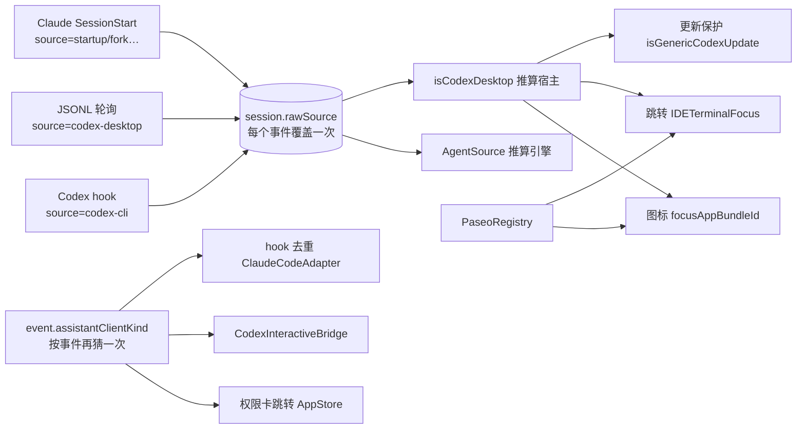
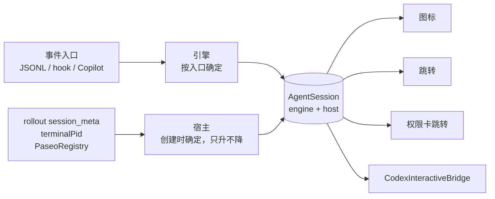

# 会话来源模型：把「引擎」和「宿主」拆开

- 状态：草案，待确认
- 日期：2026-10-30
- 仓库：peachy-code（PeachyPet），基于 main `b86c821`
- 范围：会话的来源识别、图标、点击跳转和事件去重。不涉及动画、通知文案和 hook 安装流程。

## 结论

PeachyPet 现在用 `rawSource` 这一个字符串，同时表示两件事：这个会话是**哪个代理引擎**在跑（Claude Code、Codex），以及它**运行在哪个应用里**（iTerm2、Codex 桌面版、Paseo）。这个字符串在每个事件到达时都会被覆盖，再由 4 个文件各自去猜。最近两周修的 5 个问题都出在这条管线上，2026-10-30 的数据里还能看到两个仍在发生的错误。

建议给会话增加两个明确的字段：**引擎**（engine）和**宿主**（host）。会话创建时按固定顺序确定，之后只允许从「未知」变成「已知」，不再被后续事件改写。图标、跳转、去重都只读这两个字段。

## 现在的问题

### 一个字段两种含义

事件里的 `source` 有三种来源，含义并不相同：

| 写入方 | 写入的值 | 实际含义 |
|---|---|---|
| Codex hook（经 `--source` 参数注入） | `codex-cli` | 引擎是 Codex，事件从 hook 通道来 |
| Codex JSONL 轮询（`CodexEventMapper.normalizedSource`） | `codex-desktop` / `codex-cli` / `codex` | 引擎是 Codex，再按 rollout 元数据猜宿主 |
| Claude Code 的 SessionStart | `startup` / `resume` / `compact` / `fork` | 会话**为什么开始**，跟来源无关 |

`SessionStore.recordEvent` 每收到一个带 `source` 的事件，就把它写进会话的 `rawSource`，并用 `AgentSource(rawSource:)` 重新推算引擎。



同一个判断分散在 `SessionStore`、`IDETerminalFocus`、`AppStore`、`CodexInteractiveBridge`、`ClaudeCodeAdapter`、`PermissionPromptView` 6 个文件里，判断依据也不一致：会话这边看 `rawSource`，事件那边看 `assistantClientKind`，Paseo 又在图标和跳转两处各自插了一段查询。

### 数据上看到的后果（2026-10-30，206 个会话）

| 问题 | 数量 | 原因 |
|---|---|---|
| Claude Code 会话的引擎记成 `unknown` | 79 个（38%） | Claude 的开始原因 `fork` 48、`startup` 17、`compact` 8、`resume` 2，加上 4 个没有来源，`AgentSource` 都不认识 |
| Codex 桌面版会话被改成 `codex-cli` | 2 个 | rollout 的 `originator` 是 `Codex Desktop`，但 hook 事件后到并覆盖了 `rawSource`，跳转不再去 Codex 应用 |
| Paseo 会话被改成 `codex-cli` | 10 个 | 同上；目前靠 `PaseoRegistry` 兜住了图标和跳转 |
| 其他应用驱动的 Codex 会话被当成桌面版 | 2 个 | rollout `originator` 是 `baocut`，`source: vscode` 被一律归为桌面版 |

第二行是 2026-10-28 的 hook 来源修复（`462de5e`）带出来的副作用：修复之前 Codex hook 事件不带来源，不会覆盖；修复之后带上了 `codex-cli`，于是会覆盖。根源是「每个事件都能改写来源」这个设计，补丁只会越补越多。现有的 `isGenericCodexUpdate` 就是一处这样的补丁，专门防止 `codex` 覆盖 `codex-desktop`。

`unknown` 目前影响有限，因为引擎只在少数地方用于判断「是不是 Codex」；但任何以后按引擎显示名称或图标的功能都会直接出错。

### 最近修过的同类问题

| 提交 | 问题 | 跟来源模型的关系 |
|---|---|---|
| 462de5e | Codex hook 事件没有来源，被当成 Claude，去重失效 | 引擎靠字符串猜 |
| 462de5e | 事件洪峰下重复的完成通知 | 同上，去重依赖来源判断 |
| f8e0e59 | 会话开始通知重复 | 两条通道各报一次，没有统一的会话身份 |
| b86c821 | Paseo 会话显示成 Codex，跳到 Codex 应用 | 宿主靠 `source: vscode` 猜 |
| 本文 | 桌面版会话被改成 CLI | 来源每个事件都被覆盖 |

## 设计

### 两个字段

```swift
enum AgentEngine: String, Codable { case claudeCode, codex, copilot, unknown }

enum SessionHost: Codable, Equatable {
    case terminal(bundleId: String)      // iTerm2、Ghostty、Terminal、IDE 内置终端
    case codexDesktop                    // com.openai.codex
    case paseo(agentId: String)          // sh.paseo.desktop，附带跳转用的 agentId
    case other(originator: String)       // 例如 baocut：知道是谁，但没有跳转方式
    case unknown
}
```

引擎和宿主互相独立：Paseo 可以驱动 Codex 也可以驱动 Claude，Codex 可以跑在终端也可以跑在桌面版。

Claude 的开始原因不再塞进 `source`，改成事件上单独的 `startReason` 字段，只在需要时读取。

### 引擎怎么定

按事件**从哪个入口进来**决定，不再解析字符串：

1. `CodexSessionMonitor`（JSONL 轮询）进来的 → `codex`
2. 本地 HTTP `/hook` 进来、来源标记为 `codex-*` 的 → `codex`。这个标记由 `CodexHookInstaller` 注册时写进命令（`--source codex-cli`）
3. `/hook` 进来、来源标记为 `copilot` 的 → `copilot`。Copilot 没有自己的服务，它的 hook 脚本（`CopilotCLIInstaller`）在事件里写入 `"source":"copilot"`
4. 其他 `/hook` 事件 → `claudeCode`

第 2、3 步依赖的标记都是 PeachyPet 自己的安装器写进去的，属于我们控制的约定，跟 Claude 的开始原因不会冲突。

### 宿主怎么定

会话创建时按下面的顺序取第一个能确定的结果：

| 顺序 | 依据 | 结果 |
|---|---|---|
| 1 | `PaseoRegistry` 能查到这个会话 ID | `paseo(agentId)` |
| 2 | Codex：rollout 第一行 `session_meta.originator` 是 `Codex Desktop` | `codexDesktop` |
| 3 | Codex：`originator` 是 `codex-tui` / `codex_exec`，或事件带 `terminalPid` | `terminal(bundleId)` |
| 4 | Codex：`originator` 是其他值（如 `baocut`、`codex_cli_rs` 但不在 Paseo 注册表里） | `other(originator)` |
| 5 | Claude：事件带 `terminalPid` | `terminal(bundleId)` |
| 6 | 都不满足 | `unknown` |

读 `originator` 需要找到会话的 rollout 文件。Codex 事件大多带 `transcript_path`（2026-10-30 的 `events.json` 里，340 条 `codex-cli` 事件中有 278 条）；没带的，用会话 ID 去 `CodexSessionMonitor` 已经跟踪的文件里找，rollout 文件名就以会话 ID 结尾。这样不管会话是从 hook 还是从 JSONL 先发现的，都读同一份 `session_meta`，结果一致。

**更新规则只有一条：宿主只能从 `unknown` 变成已知值，或者从任意值变成 `paseo`。** 后者是因为 Paseo 记录比会话启动早（实测 35 条记录全部早 0.04 到 5.2 秒），正常情况下第 1 步就能命中，留这条是为了兼容注册表扫描刚好错过的情况。后续事件里的 `source` 不再改写宿主，`isGenericCodexUpdate` 这类保护可以删掉。

### 改完后谁读什么



| 位置 | 现在 | 改后 |
|---|---|---|
| `AgentSession.focusAppBundleId` | Paseo 查询 + `isCodexDesktop` + PID 反查 | `switch host` |
| `IDETerminalFocus.focusSession` | Paseo 查询 + `isCodexDesktop` + 终端解析 | `switch host`，终端解析只在 `.terminal` / `.unknown` 时走 |
| `AppStore` 权限卡跳转 | `event.assistantClientKind == .codexDesktop` | 找到会话后读 `host` |
| `CodexInteractiveBridge` | 自己用 `AgentSource(rawSource:)` 和 `assistantClientKind` 判断 | 读会话的 `engine` 和 `host` |
| `ClaudeCodeAdapter` 的 hook 去重 | `assistantClientKind != .claude` | 按入口得到的 `engine == .codex` |
| `SessionStore.recordEvent` | 每个事件改写 `rawSource` 和 `agentSource` | 只按更新规则改 `host`，不动 `engine` |

`rawSource` 保留为只读的诊断字段，写入日志，方便排查，但不再参与任何判断。

### 旧数据迁移

`sessions.json` 解码时，没有 `engine` / `host` 字段的旧会话按下面的规则补齐，不需要单独的迁移步骤：

- 引擎：`agentSource == .codex` → `codex`；否则当前数据里都是 Claude 会话 → `claudeCode`
- 宿主：先查 `PaseoRegistry`；再按 `transcriptPath` 读 rollout 的 `originator`；再看 `terminalBundleId`；都没有就是 `unknown`

## 分两步做

**第一步：会话层（解决现存的两个错误）**

- 新增 `engine`、`host` 字段和宿主解析，接入表中 6 个读取位置
- 删除 `isCodexDesktop`、`isGenericCodexUpdate`，以及图标和跳转里各自的 Paseo 查询
- 预计改动 `SessionStore`、`IDETerminalFocus`、`AppStore`、`CodexInteractiveBridge`、`ClaudeCodeAdapter`、`PermissionPromptView`，新增一个宿主解析文件

**第二步：事件层**

- 事件上增加 `channel`（hook / jsonl）和 `startReason`，`source` 只在入口处用来确定引擎
- 去掉 `AgentEvent.assistantClientKind` 的字符串猜测

第二步不影响用户可见行为，可以在第一步稳定后再做，也可以不做。

## 怎么验证

1. **单元测试**：宿主解析表的每一行各一条；「后续事件不改写宿主」一条；「unknown 升级为已知」一条；旧 `sessions.json` 解码一条。
2. **真实数据回放**：用解析逻辑跑一遍当前的 206 个会话，预期：
   - 引擎为 `unknown` 的会话从 79 个降到 0 个
   - `originator: Codex Desktop` 的 12 个会话全部是 `codexDesktop`（其中 2 个现在是错的）
   - Paseo 注册表里能查到的 78 个会话全部是 `paseo`
   - `originator: baocut` 的 2 个会话是 `other`，不再被当成桌面版
   - 没有 rollout 文件、也没有终端 PID 的旧会话是 `unknown`，数量单独报告（未量化：需要回放时统计）
3. **全量测试**：当前 302 条全部通过。
4. **真机**：在 iTerm2 的 Codex CLI、Codex 桌面版、Paseo 里各开一个会话，确认三者的图标和 ⌘↵ 跳转都正确。

## 风险和不做的事

- **读 rollout 文件的开销**：只在会话创建或宿主为 `unknown` 时读第一行，跟现有 `CodexSessionMonitor.readFirstLine` 一样最多读 128KB，不在每次渲染时读。
- **`other(originator)` 没有跳转目标**：这类会话点击后什么都不做，比现在跳到错误的应用更好。识别出新的宿主后再加一个枚举值。
- **不做**：不改 hook 安装流程，不改通知文案，不改动画状态机，不引入 Paseo 之外的私有目录读取。

## 需要你决定

1. 是否按「两个字段、只升不降」的方向做。
2. 第二步要不要做，还是第一步完成后先观察。
3. 宿主为 `other` 的会话点击后什么都不做，你能否接受。另一个选择是：仍然尝试按终端 PID 去跳转。
